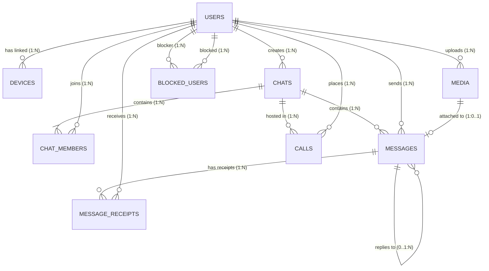

# WhatsApp Messaging Database: Schema Design Document (CP1)
**Team:** T0004 | **Section:** D | **Mentor:** Omkar  
**Repository:** [DE_Project_2026](https://github.com/Omprakash-7/DE_Project_2026)  
**Database Engine:** PostgreSQL 15+ | **Schema Name:** `whatsapp`  

---

## 1. Schema Overview & Architecture
The WhatsApp Messaging schema manages high-volume direct and group conversations, multimedia delivery, multi-device sync, call tracking, and user privacy. 

### Key Architectural Guidelines
1. **Zero Index Tuning in CP1:** Only constraints (`PRIMARY KEY`, `FOREIGN KEY`, `UNIQUE`, `NOT NULL`, `CHECK`) are implemented. PostgreSQL creates underlying B-Tree indexes automatically for `PRIMARY KEY` and `UNIQUE` constraints. No secondary performance indexes are added in Phase 2 to ensure untuned baseline timings for Phase 3.
2. **Data-Driven Typing:** IDs are sized appropriately (`INTEGER` up to 2.14B, `BIGINT` for message and receipt high-water marks). Timestamps carry explicit time zones (`TIMESTAMPTZ`) to honor the `+05:30` IST production offsets.
3. **Write-Path Compatibility:** Default values are provided for write workload operations (`is_forwarded DEFAULT false`, `is_deleted DEFAULT false`, nullable receipt timestamps for bulk insertions in query `W04`).

---

## 2. Comprehensive Data Dictionary

### 2.1 Table: `whatsapp.users`
Stores registered user identities and account statuses.
| Column | Type | Nullable | Constraints | Viva Defense & Business Justification |
| :--- | :--- | :---: | :--- | :--- |
| `user_id` | `INTEGER` | **NO** | `PRIMARY KEY` | Surrogate identifier for efficient integer joins across all child tables. |
| `phone_e164` | `VARCHAR(16)` | **NO** | `UNIQUE`, `CHECK (~ '^\+[1-9][0-9]{7,14}$')` | E.164 phone number format (+ followed by country and subscriber number). Natural key. |
| `display_name` | `VARCHAR(100)`| **NO** | `NOT NULL` | User screen name shown in chat headers and message bubbles. |
| `about` | `TEXT` | YES | None | Optional user bio/status phrase (e.g. "Available", "Busy", or custom status). |
| `is_business` | `BOOLEAN` | **NO** | `DEFAULT false` | Flags business accounts for catalog and messaging API support. |
| `joined_on` | `DATE` | **NO** | `NOT NULL` | Calendar date the account was registered. Stored as `DATE` without time component. |
| `last_seen_at` | `TIMESTAMPTZ` | YES | `CHECK (>= joined_on)` | Online presence timestamp. Nullable for users who set privacy to "Nobody". |
| `status` | `VARCHAR(10)` | **NO** | `CHECK (IN ('ACTIVE', 'BANNED', 'DELETED'))` | Account lifecycle state. Protects against unauthorized logins or spam accounts. |

---

### 2.2 Table: `whatsapp.devices`
Tracks multi-device endpoints (phone primary, WhatsApp Web, desktop clients).
| Column | Type | Nullable | Constraints | Viva Defense & Business Justification |
| :--- | :--- | :---: | :--- | :--- |
| `device_id` | `INTEGER` | **NO** | `PRIMARY KEY` | Unique surrogate ID for linked client hardware/session. |
| `user_id` | `INTEGER` | **NO** | `FK -> users(user_id) ON DELETE CASCADE` | Parent account. Deleting user account drops all linked device sessions. |
| `device_type` | `VARCHAR(10)` | **NO** | `CHECK (IN ('ANDROID','IOS','WEB','DESKTOP'))` | Client platform type used for message formatting and push routing. |
| `app_version` | `VARCHAR(20)` | **NO** | `CHECK (~ '^[0-9]+(\.[0-9]+)+$')` | Client build version used for feature compatibility gates. |
| `registered_at`| `TIMESTAMPTZ` | **NO** | `NOT NULL` | Device pairing timestamp. |
| `last_active_at`| `TIMESTAMPTZ`| **NO** | `CHECK (>= registered_at)` | Heartbeat timestamp used by security sweeps (Query `R23`) to auto-logout stale sessions. |

---

### 2.3 Table: `whatsapp.chats`
Container for conversation sessions.
| Column | Type | Nullable | Constraints | Viva Defense & Business Justification |
| :--- | :--- | :---: | :--- | :--- |
| `chat_id` | `INTEGER` | **NO** | `PRIMARY KEY` | Surrogate conversation stream ID. |
| `chat_type` | `VARCHAR(10)` | **NO** | `CHECK (IN ('DIRECT', 'GROUP'))` | Conversation type. Governs delivery rules and UI presentation. |
| `group_name` | `VARCHAR(100)`| YES | `CHECK (logic tied to chat_type)` | Must be NULL for `DIRECT` chats; mandatory (`NOT NULL`) for `GROUP` chats. |
| `created_by` | `INTEGER` | **NO** | `FK -> users(user_id) ON DELETE RESTRICT` | User who created the group or initiated the conversation. Restricted from deletion. |
| `created_at` | `TIMESTAMPTZ` | **NO** | `NOT NULL` | Chat creation timestamp. |

---

### 2.4 Table: `whatsapp.chat_members`
Associative junction table linking users to chats with roles and mute settings.
| Column | Type | Nullable | Constraints | Viva Defense & Business Justification |
| :--- | :--- | :---: | :--- | :--- |
| `chat_id` | `INTEGER` | **NO** | `PK, FK -> chats(chat_id) ON DELETE CASCADE` | Associated chat container. |
| `user_id` | `INTEGER` | **NO** | `PK, FK -> users(user_id) ON DELETE CASCADE` | Participant user ID. |
| `role` | `VARCHAR(10)` | **NO** | `CHECK (IN ('ADMIN', 'MEMBER'))` | Admin privileges (changing subject, managing members, removing users). |
| `joined_at` | `TIMESTAMPTZ` | **NO** | `NOT NULL` | Timestamp when user joined or was added to the chat. |
| `left_at` | `TIMESTAMPTZ` | YES | `CHECK (>= joined_at)` | NULL if user is currently an active member; populated when user leaves or is kicked. |
| `is_muted` | `BOOLEAN` | **NO** | `DEFAULT false` | Notification suppression flag per user per chat. |

---

### 2.5 Table: `whatsapp.media`
Binary multimedia metadata and deduplication hashes.
| Column | Type | Nullable | Constraints | Viva Defense & Business Justification |
| :--- | :--- | :---: | :--- | :--- |
| `media_id` | `INTEGER` | **NO** | `PRIMARY KEY` | Unique media file identifier. |
| `uploader_id` | `INTEGER` | **NO** | `FK -> users(user_id) ON DELETE RESTRICT` | Uploader reference for audit and quota tracking. |
| `media_type` | `VARCHAR(10)` | **NO** | `CHECK (IN ('IMAGE','AUDIO','VIDEO','DOCUMENT'))`| High-level multimedia payload category. |
| `mime_type` | `VARCHAR(50)` | **NO** | `CHECK (consistent with media_type)` | Exact standard MIME string (e.g. `image/jpeg`, `application/pdf`). |
| `size_bytes` | `BIGINT` | **NO** | `CHECK (> 0)` | Storage byte size. `BIGINT` prevents overflow on high-res media. |
| `sha256` | `CHAR(64)` | **NO** | `CHECK (~ '^[0-9a-f]{64}$')` | **NOT UNIQUE** cryptographic hash used by storage deduplication (Query `R24`). |
| `uploaded_at` | `TIMESTAMPTZ` | **NO** | `NOT NULL` | Media upload completion timestamp. |

---

### 2.6 Table: `whatsapp.messages`
Core transactional log of messages, replies, forwarded items, and deletes.
| Column | Type | Nullable | Constraints | Viva Defense & Business Justification |
| :--- | :--- | :---: | :--- | :--- |
| `message_id` | `BIGINT` | **NO** | `PRIMARY KEY` | `BIGINT` accommodates massive global message volumes beyond 2.14B rows. |
| `chat_id` | `INTEGER` | **NO** | `FK -> chats(chat_id) ON DELETE CASCADE` | Chat stream where the message was sent. |
| `sender_id` | `INTEGER` | **NO** | `FK -> users(user_id) ON DELETE RESTRICT` | Message author. RESTRICT guarantees non-repudiation and auditability. |
| `sent_at` | `TIMESTAMPTZ` | **NO** | `NOT NULL` | Server ingest timestamp. Primary timeline sorting order. |
| `message_type`| `VARCHAR(10)` | **NO** | `CHECK (IN ('TEXT','IMAGE','AUDIO','VIDEO','DOCUMENT','LOCATION'))` | Determines client bubble rendering and payload requirements. |
| `body` | `TEXT` | YES | `CHECK (conditional on type & deletion)`| Message text content or caption. NULL for media without caption or deleted messages. |
| `media_id` | `INTEGER` | YES | `FK -> media(media_id) ON DELETE SET NULL` | Reference to uploaded attachment. Set to NULL when message is deleted. |
| `reply_to_message_id`| `BIGINT`| YES | `FK -> messages(message_id) ON DELETE SET NULL` | Parent message reference for threaded reply chains (Query `R25`). |
| `is_forwarded`| `BOOLEAN` | **NO** | `DEFAULT false` | Spam detection metric (Query `R12`). |
| `is_deleted` | `BOOLEAN` | **NO** | `DEFAULT false` | Soft-delete flag ("Delete for everyone"). Clears body and media_id. |
| `edited_at` | `TIMESTAMPTZ` | YES | `CHECK (>= sent_at)` | Timestamp when the message body was updated. NULL if never edited. |

---

### 2.7 Table: `whatsapp.message_receipts`
Per-recipient delivery and read acknowledgment logs.
| Column | Type | Nullable | Constraints | Viva Defense & Business Justification |
| :--- | :--- | :---: | :--- | :--- |
| `message_id` | `BIGINT` | **NO** | `PK, FK -> messages(message_id) ON DELETE CASCADE` | Associated message. |
| `user_id` | `INTEGER` | **NO** | `PK, FK -> users(user_id) ON DELETE CASCADE` | Recipient participant. |
| `delivered_at`| `TIMESTAMPTZ`| YES | None | Populated when message reaches recipient client (double tick ✓✓). |
| `read_at` | `TIMESTAMPTZ`| YES | `CHECK (read_at IS NULL OR read_at >= delivered_at)`| Populated when user opens chat (blue tick ✓✓). Cannot precede delivery. |

---

### 2.8 Table: `whatsapp.calls`
Voice and video call session records.
| Column | Type | Nullable | Constraints | Viva Defense & Business Justification |
| :--- | :--- | :---: | :--- | :--- |
| `call_id` | `INTEGER` | **NO** | `PRIMARY KEY` | Surrogate call session ID. |
| `chat_id` | `INTEGER` | **NO** | `FK -> chats(chat_id) ON DELETE CASCADE` | Associated direct chat or group where call was placed. |
| `caller_id` | `INTEGER` | **NO** | `FK -> users(user_id) ON DELETE RESTRICT` | Call initiator. Retained for CDR telecommunications reporting. |
| `call_type` | `VARCHAR(10)` | **NO** | `CHECK (IN ('VOICE', 'VIDEO'))` | Media stream category. |
| `started_at` | `TIMESTAMPTZ` | **NO** | `NOT NULL` | Ringing start timestamp. |
| `answered_at`| `TIMESTAMPTZ` | YES | `CHECK (>= started_at)` | Call pickup timestamp (NULL if missed, rejected, or connection failed). |
| `ended_at` | `TIMESTAMPTZ` | YES | `CHECK (>= coalesce(answered_at, started_at))`| Call teardown timestamp (NULL only if network fails before connect). |
| `status` | `VARCHAR(15)` | **NO** | `CHECK (IN ('COMPLETED','MISSED','REJECTED','FAILED'))` | Call completion state machine. |

---

### 2.9 Table: `whatsapp.blocked_users`
Directed privacy blocking relationships.
| Column | Type | Nullable | Constraints | Viva Defense & Business Justification |
| :--- | :--- | :---: | :--- | :--- |
| `blocker_id` | `INTEGER` | **NO** | `PK, FK -> users(user_id) ON DELETE CASCADE` | User enforcing the block. |
| `blocked_id` | `INTEGER` | **NO** | `PK, FK -> users(user_id) ON DELETE CASCADE` | Targeted blocked user. |
| `blocked_at` | `TIMESTAMPTZ` | **NO** | `NOT NULL` | Timestamp when block was created. |

---

## 3. Foreign Key & ON DELETE Strategy Matrix

| Child Table | Foreign Key Column | Parent Referenced Table | Action on Delete | Detailed Engineering Rationale |
| :--- | :--- | :--- | :---: | :--- |
| `devices` | `user_id` | `users(user_id)` | **CASCADE** | A device registration is an authenticated hardware session strictly owned by a user account. If the user account is purged, all linked device sessions are invalid. |
| `chats` | `created_by` | `users(user_id)` | **RESTRICT** | Group chats represent shared collective history across dozens of other participants. Restricting deletion prevents accidental destruction or abandonment of shared groups. |
| `chat_members`| `chat_id` | `chats(chat_id)` | **CASCADE** | Membership roster entries only exist inside a chat. Deleting the chat automatically purges all roster entries. |
| `chat_members`| `user_id` | `users(user_id)` | **CASCADE** | If an account is deleted, removing their membership rows cleans up the participant list in all groups. |
| `media` | `uploader_id` | `users(user_id)` | **RESTRICT** | Shared media files remain accessible to chat participants long after an uploader leaves. Preserves evidence and file integrity. |
| `messages` | `chat_id` | `chats(chat_id)` | **CASCADE** | Messages are physically contained within a chat stream. Deleting a chat cascades to remove all associated message history. |
| `messages` | `sender_id` | `users(user_id)` | **RESTRICT** | Message logs require legal non-repudiation. A sender account cannot be erased while active messages exist in audit logs. |
| `messages` | `media_id` | `media(media_id)` | **SET NULL** | If a media file is purged from blob storage to reclaim space, the message bubble and timestamp remain intact with media unlinked. |
| `messages` | `reply_to_message_id`| `messages(message_id)` | **SET NULL** | If an original message is deleted, subsequent reply messages in the thread must not disappear; their reply pointer is simply unlinked. |
| `message_receipts`| `message_id`| `messages(message_id)` | **CASCADE** | Receipts are metadata tracking a specific message. Deleting the message purges all recipient receipts. |
| `message_receipts`| `user_id` | `users(user_id)` | **CASCADE** | Deleting a recipient account removes their pending or read acknowledgment rows. |
| `calls` | `chat_id` | `chats(chat_id)` | **CASCADE** | Call history logged in a chat is purged if the chat container is purged. |
| `calls` | `caller_id` | `users(user_id)` | **RESTRICT** | Caller identity is mandatory for billing and telecom compliance. |
| `blocked_users`| `blocker_id`| `users(user_id)` | **CASCADE** | Deleting the blocker account lifts all active outbound blocks. |
| `blocked_users`| `blocked_id`| `users(user_id)` | **CASCADE** | Deleting the targeted account removes obsolete inbound blocks. |

---

## 4. Integrity Checks & Verification Results

To confirm schema correctness beyond basic foreign keys, we executed 7 cross-table integrity checks against all 877,738 rows of seed data:

### Integrity Check 1: Message sender is or was a member of the chat
```sql
SELECT count(*) AS invalid_senders
FROM messages m
WHERE NOT EXISTS (
    SELECT 1 FROM chat_members cm
    WHERE cm.chat_id = m.chat_id AND cm.user_id = m.sender_id
);
```
* **Result:** `0` violations. Every message was authored by a valid chat participant.

### Integrity Check 2: Reply message belongs to the exact same chat
```sql
SELECT count(*) AS cross_chat_replies
FROM messages child
JOIN messages parent ON parent.message_id = child.reply_to_message_id
WHERE child.chat_id <> parent.chat_id;
```
* **Result:** `0` violations. Reply threads are strictly scoped to the same conversation.

### Integrity Check 3: Reply message cannot precede the original message
```sql
SELECT count(*) AS time_travel_replies
FROM messages child
JOIN messages parent ON parent.message_id = child.reply_to_message_id
WHERE child.sent_at < parent.sent_at;
```
* **Result:** `0` violations. Chronological causality is preserved.

### Integrity Check 4: Direct chats have exactly two members
```sql
SELECT c.chat_id, count(cm.user_id) AS member_count
FROM chats c
LEFT JOIN chat_members cm ON cm.chat_id = c.chat_id
WHERE c.chat_type = 'DIRECT'
GROUP BY c.chat_id
HAVING count(cm.user_id) <> 2;
```
* **Result:** `0` violations. All 20,000 direct chats contain exactly 2 members.

### Integrity Check 5: Receipt user is a member of the chat
```sql
SELECT count(*) AS non_member_receipts
FROM message_receipts r
JOIN messages m ON m.message_id = r.message_id
WHERE NOT EXISTS (
    SELECT 1 FROM chat_members cm
    WHERE cm.chat_id = m.chat_id AND cm.user_id = r.user_id
);
```
* **Result:** `0` violations. Receipts are generated only for legitimate chat members.

### Integrity Check 6: Non-deleted TEXT messages must not have an empty body
```sql
SELECT count(*) AS empty_text_messages
FROM messages
WHERE is_deleted = false AND message_type = 'TEXT' AND (body IS NULL OR length(trim(body)) = 0);
```
* **Result:** `0` violations. Every active text message contains readable text.

### Integrity Check 7: Read timestamp strictly greater than or equal to delivery timestamp
```sql
SELECT count(*) AS invalid_receipt_flow
FROM message_receipts
WHERE read_at IS NOT NULL AND (delivered_at IS NULL OR read_at < delivered_at);
```
* **Result:** `0` violations. No message is marked read without prior or simultaneous delivery.

---

## 5. Identified Data Problems & Edge Cases

1. **The 557 "Orphaned" Media Files:**
   * `media.csv` contains 27,634 uploaded files, but `messages.csv` only contains 27,077 non-deleted media messages.
   * **Root Cause:** 557 messages were deleted via "Delete for everyone" (`is_deleted = true`). The application set `messages.media_id = NULL` and `messages.body = NULL`, leaving the original file record in `media`. This represents an intentional decoupling of message references from blob storage.
2. **Problem P6 / Query R13 Empty Report (Three-Valued Logic NULL Pitfall):**
   * Problem P6 reports that group admins query unanswered questions, but the report always returns empty.
   * **Root Cause:** Query R13 filters using `WHERE m.message_id NOT IN (SELECT r.reply_to_message_id FROM messages r)`. In `messages`, 105,090 rows have `reply_to_message_id IS NULL`. In SQL three-valued logic, `x NOT IN (..., NULL)` evaluates to `UNKNOWN` (treated as FALSE). This is a known SQL query bug that our optimization phase will rewrite to `NOT EXISTS`.
3. **Media SHA-256 Hashes Contain 3,215 Duplicates:**
   * 27,634 media rows share 24,419 distinct SHA-256 hashes. Multiple users upload the exact same viral image or document.
   * Marking `sha256` as `UNIQUE` would cause `\copy` to fail. Omitting `UNIQUE` enables deduplication analysis (Query `R24`).
4. **User Privacy Last Seen:**
   * 624 users have `last_seen_at IS NULL` because they chose privacy settings hiding their presence. The column must remain nullable.

---

## 6. Entity Relationship Diagram (ERD)

The complete ER diagram is available in the repository as both an image and vector format:
* PNG: [`diagrams/er_diagram.png`](file:///Users/omprakashsharma/Desktop/DE_Project_2026/diagrams/er_diagram.png)
* SVG: [`diagrams/er_diagram.svg`](file:///Users/omprakashsharma/Desktop/DE_Project_2026/diagrams/er_diagram.svg)



---

## 7. Normalization Summary
Every table in the `whatsapp` schema satisfies **BCNF** and **3NF**:
* All candidate keys are minimal superkeys with no partial dependencies (2NF satisfied).
* No transitive functional dependencies exist between non-prime attributes (3NF satisfied).
* Controlled denormalization (such as storing `messages.message_type` alongside `media.media_type`) is strictly justified by high-throughput messaging requirements and safeguarded by CHECK constraints.
